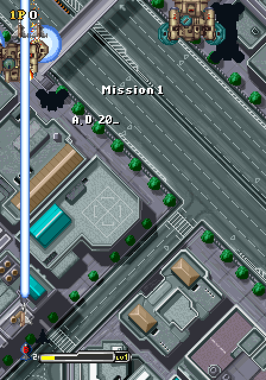
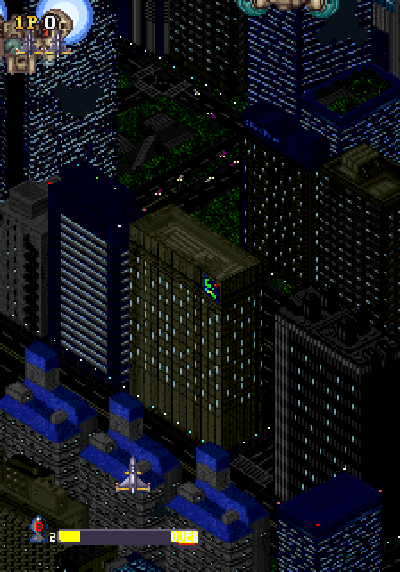
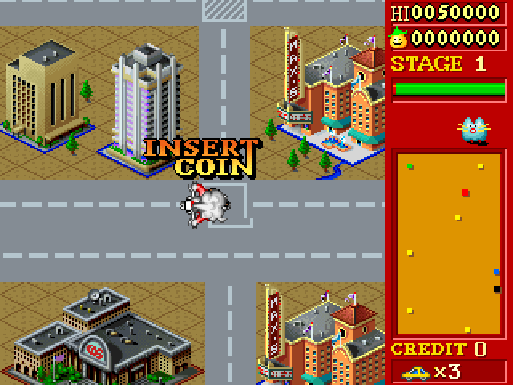

# 1945k III - MiSTer FPGA Core

The Oriental Soft / Promat SPR800E hardware (1996-2000) for MiSTer:
1945k III, Solite Spirits and '96 Flag Rally, six MAME sets from one RBF.

  

*Screenshots taken on a MiSTer with this core.*

| Game | Year | Sets | Screen |
|---|---|---|---|
| 1945k III | 1999-2000 | newer (OPCX2 PCB), plus newer and older OPCX1 and the Promat license in alternatives | vertical |
| Solite Spirits | 1999 | one set | vertical |
| '96 Flag Rally | 1996 | one set | horizontal |

Hardware: 68000 at 16 MHz, two OKI M6295 (one on Flag Rally), one 16x16
tile layer and a sprite list, 512-colour palette. The CPU and sound chips
use established cores: fx68k (Jorge Cwik) and jt6295 (Jose Tejada,
jotego); see CREDITS.md. The video hardware is new work.

## Install

### With Update All (recommended)

Add these two lines to `/media/fat/downloader.ini` on your SD card:

```ini
[shmupfan]
db_url = https://raw.githubusercontent.com/shmupfan/Distribution/main/db.json
```

Then run Update All (or `downloader`) from the Scripts menu. It installs the
core and every MRA, including the alternative sets, and keeps them up to
date on later runs. The same entry also brings in other
[shmupfan](https://github.com/shmupfan/Distribution) cores as they are
released.

### Manually

Copy `releases/Arcade-1945kIII_*.rbf` to `/media/fat/_Arcade/cores/` and
the MRA files in `releases/` to `/media/fat/_Arcade/`. Alternative sets
are in `releases/_alternatives/` and go to
`/media/fat/_Arcade/_alternatives/`.

### ROMs

You need the MAME ROM sets (0.288/0.289 naming) in
`/media/fat/games/mame/`: `1945kiii.zip`, `slspirit.zip`,
`flagrall.zip`. The 1945k III alternative sets load from the parent zip.
No ROM data is included in this repository.

## Controls and options

Buttons 1 to 4, Start and Coin, as in the MAME driver (Flag Rally uses
two buttons). Keyboard uses the MAME defaults: arrows, Left Ctrl, Left
Alt, Space, Left Shift, 1/2 start, 5/6 coin; player 2 on R/F/D/G, A, S,
Q, W. P pauses and resumes.

OSD: DIP switches per set (from the MAME driver), aspect ratio,
orientation for the vertical games, scandoubler options, HDMI scale
(Normal, V-Integer, Narrower or Wider HV-Integer), pause while the OSD is
open (on by default), and volume (Normal, +6 dB, -6 dB, -12 dB). With
Orientation set to Horizontal, the 224-line 1945k III picture can also be
cropped to 216 lines (an exact 5x on 1080p) with an adjustable offset;
the crop is not offered for rotated output (the frame buffer keeps the
whole picture) or for Flag Rally's 240 lines.
The board has a volume pot after the sound chips, so the absolute level
is a choice: Normal puts 1945k III gameplay at about the same loudness
as other arcade cores, without clipping.

## Accuracy notes

MAME is the reference: the video was checked pixel for pixel against
MAME on 7,821 frames of all six sets, each full system was booted from
power-on and compared with MAME frame by frame (every scroll, control and
sound write equal in order and value), and the sound output was compared
with MAME's sample by sample. Where MAME and the real hardware are likely
to differ, the core follows the hardware, and the difference is logged as
a research item in [docs/PLAN.md](docs/PLAN.md) and the findings
documents.

- **Mid-frame sprite copies.** On a few scene changes the game copies the
  sprite list partway down the screen. The core draws line by line, so
  the new sprites appear from the next line; MAME draws the whole frame
  at once. The core's behaviour is the likely one, not yet confirmed on a
  board (R3).
- **CPU timing.** fx68k runs the 68000's E-clock synchronised interrupt
  acknowledge, which MAME approximates. Writes land within a few pixels
  of MAME's; on Flag Rally the main program drifts further over time
  (docs/m2_findings.md, R8).
- **Sound.** MAME 0.288 runs the M6295 at 7,575 Hz (an integer division)
  instead of 7,575.76 Hz, which moves the end of one long Flag Rally
  music track by one frame, so that attract mode separates from MAME
  after about 30 s. The M6295 core is patched to follow MAME where jt6295
  differed (stop byte, a start to a busy channel, stop then start); see
  CREDITS.md and docs/m3_findings.md.
- **Continue countdown.** It is silent, as in MAME: the game sends no
  sound commands between the game-over phrase and the attract restart.

Switching between a vertical set and Flag Rally without reloading the core
works since the 20261004 release: video sync now keeps running during ROM
loading (docs/m4_findings.md 9.1).

## Architecture

- 68000 (fx68k) at 16 MHz with zero-wait program ROM reads from SDRAM
- Line renderer: one 32x32 map of 16x16 8bpp tiles with scroll, sprites
  with the MAME per-frame entry budget, read live as the beam draws
- Two M6295 with bank switching
- 96 MHz system clock, 6.75 MHz pixel clock: 432 x 262 at 59.64 Hz
  (1945k III, Solite Spirits) or 432 x 315 at 49.60 Hz (Flag Rally)

## Layout

```
Arcade-1945kIII.*   Quartus 17 project (qpf/qsf/sdc/srf) and the MiSTer
                    shell (Arcade-1945kIII.sv)
files.qip           Quartus file list, sourced by the qsf
sys/                MiSTer framework
rtl/                the core (k3_*.sv) + rtl/vendor/ cores
releases/           released RBF + MRA files (_alternatives/ for alt sets)
docs/               system spec, plan and research items, findings per
                    milestone
reference/          vendored MAME source (BSD-3-Clause, the behavioural
                    reference)
sim/                Verilator harness: frame replay against MAME, system
                    boots, sound comparison, board-level SDRAM simulation
tools/              ROM image builder, MRA generator (proves each MRA
                    rebuilds the SDRAM image byte for byte), build script
```

## Building and verifying

- Simulation: Verilator 5.x and Python 3; the MAME reference captures
  need MAME 0.288 and your ROM sets (`sim/Makefile`, `sim/m3.mk` and
  `sim/m4.mk` list the targets)
- Synthesis: Quartus 17 project at the repo root. Releases are only
  built from a fit with every clock meeting timing

## License and credits

GPL-3.0-or-later for the combined work. Vendored components keep their
own licences and headers. See `LICENSE` and `CREDITS.md`. The core
relies on MAME's 1945k III driver by David Haywood and contributors.

Development used Anthropic's Claude as a coding tool.
